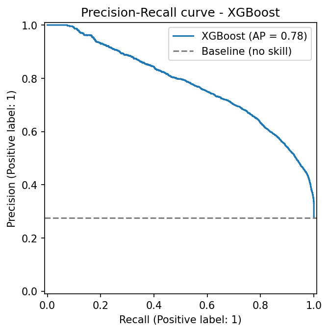
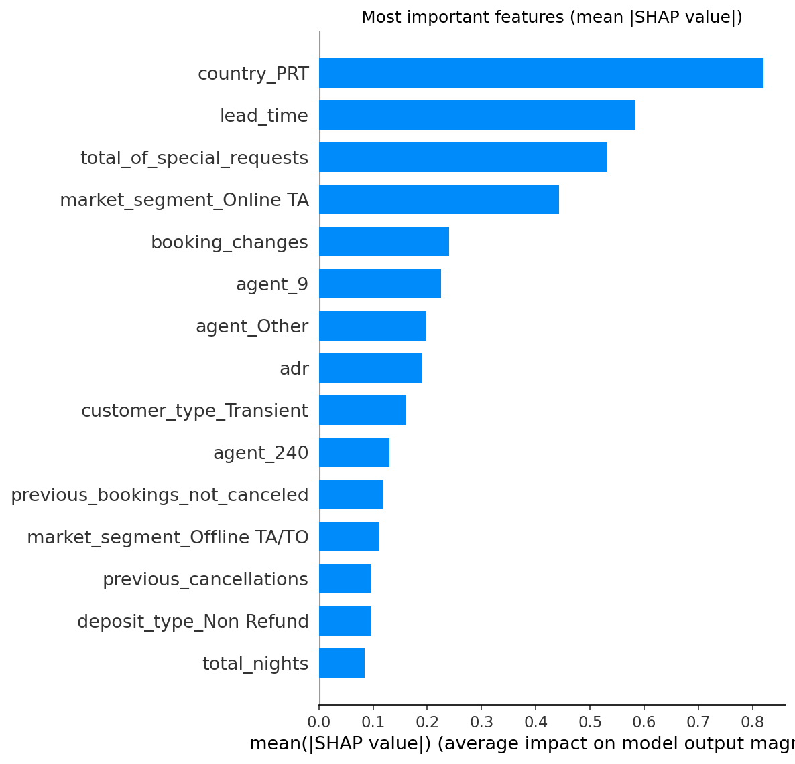

# ml-hotel-booking-cancellation
*Predict hotel booking cancellations, understand which customers are most at risk and what hotels could do to reduce them*

Booking cancellations are one of the main sources of revenue loss for hotels: a room cancelled at the last minute is often impossible to resell, and hotels try to protect themselves with restrictive policies (non-refundable rates, deposits) or with overbooking, which in turn can damage customer satisfaction if it goes wrong.

This project analyses real bookings from two hotels in Portugal (a City Hotel and a Resort Hotel) to predict whether a booking will be cancelled, using only the information available at booking time, and to understand which factors and customer segments are most associated with cancellations. The analysis follows the **CRISP-DM** methodology.

Final assignment – *Machine Learning and Data Mining (Module I)*, University of Bologna, A.Y. 2026/27.
Author: **Martina Fava**

## Main tasks
- Understand the business problem and the cost of a cancellation for the hotel
- Explore and clean the data, removing anomalies, duplicates and variables that would cause data leakage
- Build and compare classification models to predict cancellations, using metrics suited to an imbalanced target
- Interpret the models to find the main drivers of cancellation
- Turn the results into practical suggestions on deposit policies, reminders and overbooking

## Repository structure
```text
ml-hotel-booking-cancellation/
├── hotel_booking_cancellation.ipynb   # Colab notebook with the full analysis
├── data/                              # dataset and source information
├── assets/                            # plots and figures
├── report/                            # paper (IEEE format) and presentation (PDF)
├── requirements.txt                   # Python libraries used
├── LICENSE
└── README.md
```

## Project structure
All the analysis is contained in a single notebook, organised according to the CRISP-DM phases.

```text
hotel_booking_cancellation.ipynb
├── 1. Business Understanding
│   ├── 1.1 Problem definition
│   └── 1.2 Cost of errors and choice of metrics
├── 2. Data Understanding
│   ├── 2.1 Data import
│   ├── 2.2 Attribute description
│   ├── 2.3 Target distribution
│   ├── 2.4 Exploratory analysis
│   └── 2.5 Data quality
├── 3. Data Preparation
│   ├── 3.1 Duplicates and anomalous rows
│   ├── 3.2 Missing values
│   ├── 3.3 Leakage removal
│   ├── 3.4 Feature engineering
│   └── 3.5 Encoding and train/test split
├── 4. Modeling
│   ├── 4.1 Modeling strategy
│   ├── 4.2 Baseline
│   ├── 4.3 Logistic Regression
│   ├── 4.4 Decision Tree
│   ├── 4.5 Random Forest
│   ├── 4.6 XGBoost
│   └── 4.7 Cross-validation results
├── 5. Evaluation
│   ├── 5.1 Performance on the test set
│   ├── 5.2 Confusion matrix
│   ├── 5.3 Precision-Recall curve and choice of the threshold
│   ├── 5.4 Model interpretation with SHAP
│   └── 5.5 Temporal validation
└── 6. Deployment
    ├── 6.1 Risk segmentation
    ├── 6.2 Business recommendations
    ├── 6.3 Limitations and future work
    └── 6.4 Conclusion
```

## How to run
Open the notebook in Google Colab and run all cells (*Runtime → Run all*). The dataset is loaded directly from this repository, so no manual upload is needed. The full execution takes a few minutes, mainly because of hyperparameter tuning.

## Key data preparation choices
- **31,994 duplicated rows removed**: after this step the cancellation rate drops from 37% to **27.5%**, and the apparent "Non Refund paradox" (99% of non-refundable bookings cancelled) turns out to be mostly caused by duplicated group bookings.
- **Leakage removed**: besides `reservation_status` and `reservation_status_date`, also `assigned_room_type` and `required_car_parking_spaces` were dropped, since they are mostly recorded at check-in and are therefore not available at booking time.
- Missing values handled according to their meaning (e.g. a missing `agent` means "no agency"); high-cardinality identifiers grouped into the most frequent categories.

## Results
Four models were tuned with stratified cross-validation and evaluated on a held-out test set (20%). Class imbalance was handled with class weights.

| Model | Precision | Recall | F1-score | PR-AUC |
|-------|-----------|--------|----------|--------|
| Logistic Regression | 0.534 | 0.770 | 0.630 | 0.665 |
| Decision Tree | 0.555 | 0.826 | 0.664 | 0.718 |
| Random Forest | 0.629 | 0.796 | 0.703 | 0.767 |
| **XGBoost** | **0.612** | **0.821** | **0.701** | **0.778** |

- **XGBoost** is selected as the final model, having the highest PR-AUC and a higher Recall than Random Forest, which is very close and has a slightly higher F1-score. With a decision threshold of **0.4**, chosen because missing a cancellation is more costly than a false alarm, it detects **89%** of the cancellations.
- The main drivers of cancellation (SHAP) are the **guest's country** (domestic guests cancel more), the **lead time**, the **number of special requests** (which strongly reduce the risk) and the **booking channel** (online travel agencies are riskier).
- **Risk segmentation**: the high-risk group contains only **24% of the bookings but 63% of the cancellations**.

<p align="center">
  
  
</p>

### Business recommendations
- **High risk** → partial deposit or stricter cancellation conditions
- **Medium risk** → reminder or confirmation request before arrival, invitation to personalise the stay
- **Low risk** → no action
- **Overbooking** only at aggregate level, using the expected number of cancellations per date

## Future work
- **Retrain the model periodically**: a temporal validation (train 2015–2016, test 2017) showed a drop in performance (PR-AUC 0.677), due to changes in cancellation behaviour over time
- Include **real cost data** (value of an empty room, cost of a false alarm) to choose the threshold that maximises the expected profit
- Retrain and validate the model on data from other hotels and more recent years
- Test the recommendations (e.g. reminders, deposits) on a subset of bookings to measure their real impact

## Data source
Antonio, N., Almeida, A., Nunes, L. (2019). *Hotel booking demand datasets*. Data in Brief, 22, 41–49.
Kaggle version: https://www.kaggle.com/datasets/jessemostipak/hotel-booking-demand

## License
This project is licensed under the MIT License.
